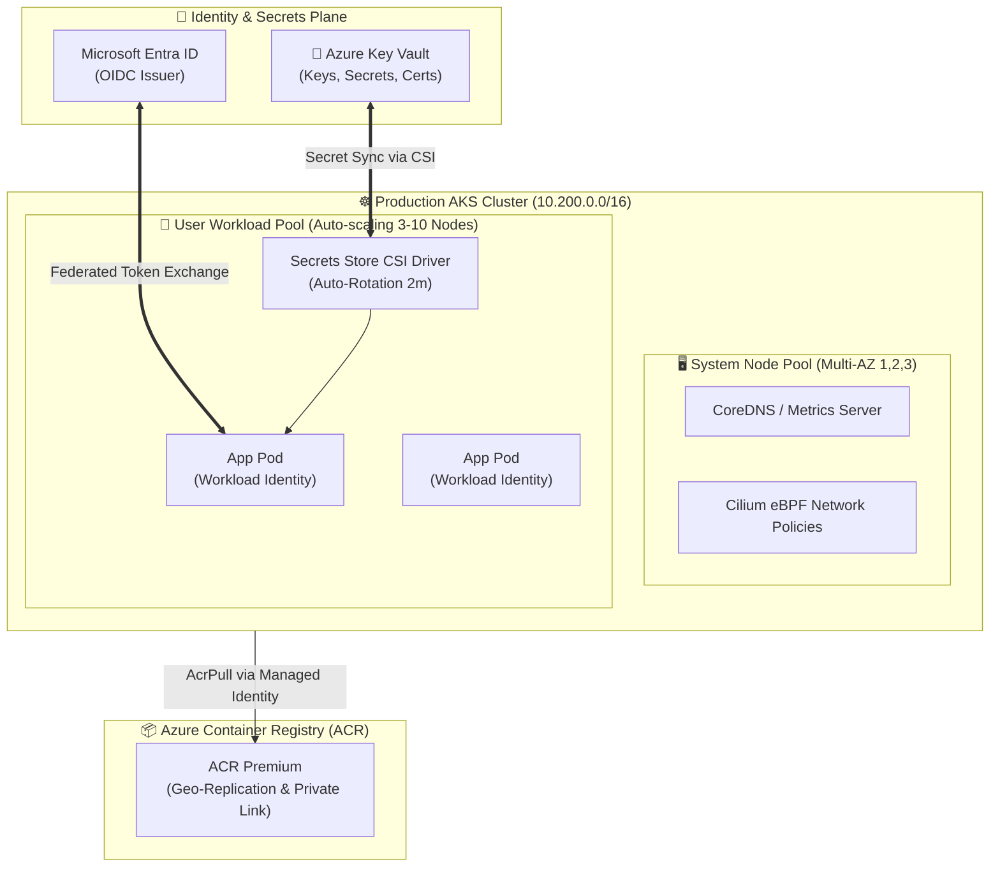

<div align="center">

# ☸️ Enterprise Azure Kubernetes Service (AKS) Infrastructure
### Production Cloud-Native Platform with Cilium eBPF, Workload Identity & Azure Key Vault CSI

[](#)
[](#)
[](#)
[](#)
[](#)

<p align="center">
  <b>Hardened, scalable, multi-tenant Kubernetes platform built on Azure with Terraform, featuring Zero-Trust Workload Identity and automated secret rotation.</b>
</p>

</div>

---

## 📌 Architecture Diagram



---

## ⚡ Key Production Capabilities

- 🔒 **Zero-Trust Workload Identity:** Microservices authenticate directly with Azure services via Microsoft Entra ID Workload Identity without hardcoded API keys or service principal secrets.
- 🚀 **Next-Gen Networking with Cilium eBPF:** High-performance Azure CNI Overlay combined with Cilium network policies delivers sub-millisecond pod-to-pod networking and L7 egress filtering.
- 🛡️ **Automated Secret Rotation:** Integrated Azure Key Vault Secrets Store CSI Driver syncs Kubernetes secrets dynamically with automatic rotation interval of 2 minutes.
- 📈 **Dynamic Elastic Auto-Scaling:** User nodepool dynamically scales from 3 to 10 nodes based on CPU/Memory thresholds and HPA (Horizontal Pod Autoscaler).
- 🧩 **Isolated System & Workload Planes:** Dedicated `systempool` tainted with `CriticalAddonsOnly` prevents application crashes from impacting core Kubernetes services.

---

## 📂 File Hierarchy

```tree
aks-cluster-infra/
├── .github/
│   └── workflows/
│       └── terraform-ci.yml      # CI pipeline for linting & Checkov security
├── .gitignore                    # Terraform and runtime ignore patterns
├── main.tf                       # AKS cluster, nodepools, ACR, and IAM bindings
├── variables.tf                  # Type-checked inputs for cluster sizing
├── outputs.tf                    # Cluster endpoints, OIDC URL, and ACR details
├── versions.tf                   # HashiCorp & Azure provider versions
├── terraform.tfvars.example      # Sample production sizing configuration
└── README.md                     # Architecture guide
```

---

## 🚀 Quick Deployment

```bash
# 1. Initialize working directory
terraform init

# 2. Validate configuration
terraform validate

# 3. Create execution plan
terraform plan -out=aks.tfplan

# 4. Deploy cluster
terraform apply aks.tfplan

# 5. Connect via kubectl
az aks get-credentials --resource-group rg-enterprise-core-prod --name aks-enterprise-core-prod
kubectl get nodes -o wide
```

---

## 📄 License
This project is open-source under the [MIT License](LICENSE).
